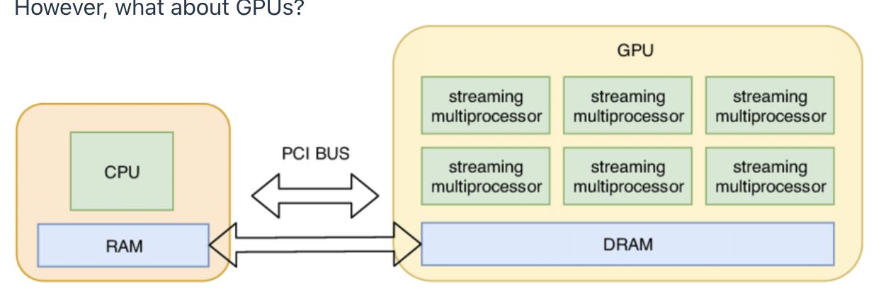
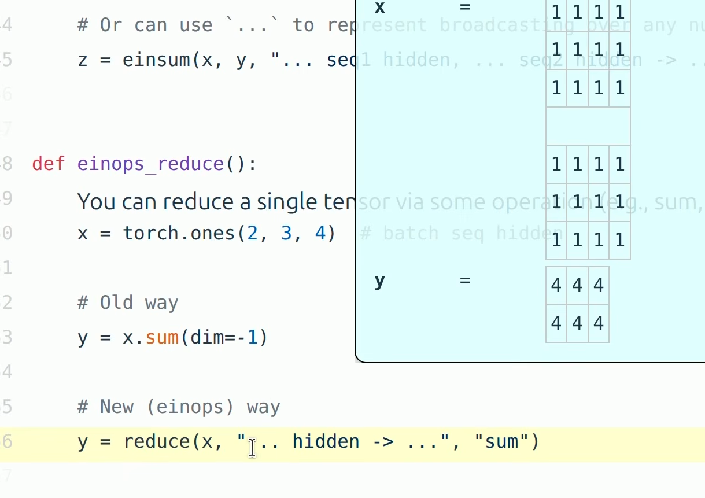
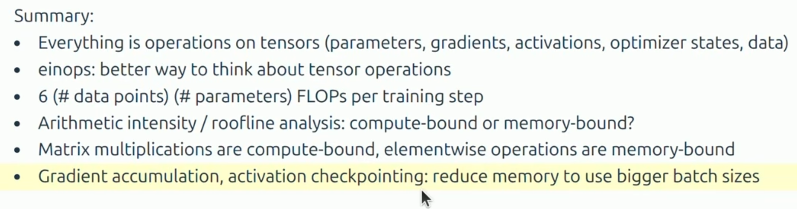

Basics

Tokenization, Model Architecture and Training
Resource Accounting:Memory and Compute Characteristics of a model
Model parameters must be moved form memory(HBM) to the comput (SMs)
Understand whether we are compute bound or memory bound

Kernels

Kernel is a function that runs on GPU
when using pytorch, each primitive operation launches a standard kernel
can write custom kernels to make GPU's go brrr
Write kernels in CUDA/Triton/CUTLASS

Parallelism

What if we have 1024 GPUS?
Shard memory (Parameters, activations,gradients and optimizer states) across GPUs
How to split computation: data,tensor,sequence, parallelism

Inference

Goal: Use the models
Infernce is also needed for reinforcement learning, tet time compute, evaluation
Two Phases: Prefill and Decode
Prefill:Tokens are given adn can process all at once(Compute Bound)
Decode: Need to generate one tooken at a time(memory-bound)
Methods to speed up decoding: Fused kernels, Continuous Batching, Speculative Decoding or use a cheaper model

Scaling

How do we scale up?
If you have 1e25 FLOPs of compute, what hyperparameters would you use to train a good model?
Scaling Recipe? FLOPs to hyperparameters
Run expermients to compute the loss at various smaller scales
For a scaling law to predict the loss of the scaling recipe at the target scale
Scaling laws dont happen automatically
Given a FLOP's budget (C = 6ND) use a bigger model or tain more tokens (D)?
TLDR D=20N
70B parameter model should be trained on ~1.4T tokens
Doesnt take into account inference costs

Data

Question: What capabilties do we want the model to have?
Multilingual? Good at conversation? Agentic coding capabilities?

Evaluation

What is the purpose of evaluation?
Internal: Guide model development
External: Measure absolute quality of a real use case
Advanced use cases: GPQA,HLE, SWE-Bench, Terminal-Bench
LM's are general purpose, require a diverse set of evalutations.

Data curation

Fairness and might have to license data
Raw data is HTML, PDF, Directories and require processing

Data processing

Transformation: convert HTML/PDF to test
Filtering: Keep high quality data, remove hamful content
Deduplciation: Save compute, avoid memorization; use Bloom filters or MinHash
Data mixing
Rewriting/Synthetic Data

Types of data: 
Pretraining data:Large and diverse
Mid-training data: high quality, including long-context
Post-training data: supervised fine-tuning (conversations, agentic traces with tool calling)

Alignment:
Weak Supervision?
Basic Template:
1) generate response from the model
2) Score responses with a human, verifier or LM Judge
3) Update h model to prefer better responses

Algorithms:
- Proximal Policy Optimization(PPO)
- Direct Policy Optimization(DPO)
- Group Relative Preference Optimzation (GRPO)

RL algortihms are unstable and hard to tune
Constantly trading off systems efficienct and on policyness.

Its all about efficiency:
Resource: Data + Hardware ( Compute, Memory , Communication Bandwidth)
How do we train the best model given a fixed set of resources?

Today we are compute constrained so desgin decisions will reflect squeezing the most out of given Systems, Tokenization, Architecture of the Model, Data filtering, Scaling laws


Tokenization

Intro to tokenization

Unicode strings are encoded into tokens and decodes token back to strings
Tokenizer is a class that implements the encode and decode methods

A word and its preceding space are part of the same token
A word at the begineeing adn in the middle are represented differently

simple tokenizer like gpt5_tokenizer
gives you indices and you can encode and decode your string using the class

Compression Ratio: Number of bytes per token

Larger the compression ratio , the shorter the sequence( good since attention is quadratic in seq length)
One could increase compression ratio by incresing vocab size( number of possible token vlaue increases) leading to sparsity

Simple tokenizer like Character Tokenizer is just using ord
as the string are in unicode which are reporesrested by numbers 
use ord and char as encoder decoder
Now there are 150K unicode characters, this is very large vocab and the compression ratio will be lower for the same sentence

Or we can use byte tokenizer
convert to sequence of bytes
vocab size? 256
Byte sequence are long and compression ratio is bad and limited vocab size

Word tokenizer

Basic NLP, Map each chunk to an integer
compression ratio is good but vocab size is huge
many words are rare and the model wont learn much about them
this doesnt prvide a fixed vocab size
new words we havent seen during training get a special UNK token which is ugly and can mess wiht calculations

BPE Tokenizer (Byte Pair Tokenizer)
Byte Pair Encoding

BPE algorithm for data compression.
Basic idea: Train the tokenizer on raw text to construct a vocabulary tailored to the data.
Intuition: Common sequences of bytes are represented by a single token, rare sequences are represented by many tokens

Sketch: start with each byte as a token, and successively merge the most common pair of adjacent tokens.

Motivation Question:
How long would it take to train a 70B parameter model on 15T tokens on 1024 H100s?
total_flops = 6*number of parameters*number of tokens
Each GPU has its own spec sheet and its speed
and mfu

Question: How long would it take to train a 70B parameter model on 15T tokens on 1024 H100s?
total_flops = 6 * 70e9 * 15e12  
h100_flop_per_sec = 1979e12 / 2
mfu = 0.5
flops_per_day = h100_flop_per_sec * mfu * 1024 * 60 * 60 * 24  
days = total_flops / flops_per_day  

Question: What's the largest model that can you can train on 8 H100s using AdamW?
h100_bytes = 80e9  
bytes_per_parameter = 2 + 2 + (4 + 4)  # parameters (2), gradients (2), optimizer state (4 + 4) 
num_parameters = (h100_bytes * 8) / bytes_per_parameter  
Caveat: activations are not accounted for (depends on batch size and sequence length), so this is an upper bound.
This is a rough back-of-the-envelope calculation.

Takeaway is resource accounting and get a sense of how resources are spent

Tensors are the basic building block for storing everything:
data, parameters, gradients, optimizer state, activations

Each tensor has a rank, which is the number of dimensions.
x = torch.zeros(4)        # rank 1 tensor (vector) 
x = torch.zeros(4, 8)     # rank 2 tensor (matrix) 
x = torch.zeros(4, 8, 2)  # rank 3 tensor 
In Transformers, will see tensors of rank 4:
B = 32   # Batch size
S = 16   # Sequence length
H = 16   # Number of heads
D = 64   # Hidden dimension per head
x = torch.zeros(B, S, H, D)

A concrete everyday example is video. A video is (frames, height, width, color):

one pixel = 3 numbers (RGB) → vector
one row of pixels → matrix
one frame (image) → rank 3
many frames → rank 4


Tensors Memory 
Almost everything are stored as floating points.

float32  has 32 bits
fp32 or single precision is the default
Traditionally, in scietific computing float32 is the baseline; you can use double precision in some cases.

By default tesnor is float32
Float is 4 bytes 

Eg x = torch.zeros(4,8)
is 4*8*4 is 128 bytes

One matrix in the feedforward layer of GPT-3:
assert get_memory_usage(torch.empty(12288 * 4, 12288)) == 2304 * 1024 * 1024  # 2.3 GB 

Since we are interested in efficiency, we try to reduce storage

Now we can do fp16, 16 bit floating point, less size and less processing time

fp16-float16

we cant really represent huge or small numbers
beacuse exponent is just 5 when comaprked to 8 in fp32

However, the dynamic range (especially for small numbers) isn't great.
x = torch.tensor([1e-8], dtype=torch.float16)  
assert x == 0  # Underflow!
If this happens when you train, you can get instability.

bf16 was developed to address this issue

bfloat16 uses the same memory as float 16 but same dynamic range as flaot32

basically moving and increasing exponent bits from 5 to 8
The only catch is that the resolution is worse, but this matters less for deep learning.
x = torch.tensor([1e-8], dtype=torch.bfloat16)  
assert x != 0  # No underflow!

Mixed precision is a strategy people take.
Training with fp32 works, but requires lots of memory.
Training with fp16 and even bf16 is risky, and you can get instability.
Solution is mixed precision training 
Use bf16 for parameters, activations, and gradients
Use fp32 for optimizer states
Pytorch has an automatic mixed precision (AMP) library.

It helps to think of floats as **scientific notation in binary**:

```
  −1.0110 × 2^5
  ↑   ↑        ↑
 sign mantissa exponent
```

Every float has a fixed budget of bits, split into three parts:
- **Sign** (1 bit): + or −.
- **Exponent**: how far the number can slide up or down, i.e. how big or how tiny it can be. More exponent bits gives more **dynamic range**.
- **Mantissa**: how many significant digits you keep. More mantissa bits gives more **resolution**, meaning finer steps between neighbouring numbers.

So "moving bits around" means: with the same total bits, do you spend them on reach (exponent) or on detail (mantissa)?

### Decimal analogy
Say you're only allowed 4 digits in total:
- 3 for digits and 1 for the power gives `1.23 × 10^5`. That's precise, but it can only go up to about 10^9.
- 2 for digits and 2 for the power gives `1.2 × 10^15`. That's coarse, but it can reach 10^99.

Same budget, different trade-off.

### The formats

| Format | Sign / Exp / Mantissa | Range (max) | Smallest step near 1.0 | Note |
|---|---|---|---|---|
| fp32 | 1 / 8 / 23 | ~3×10³⁸ | ~0.0000001 | the reference |
| fp16 | 1 / **5** / 10 | **65,504** | ~0.001 | good detail, tiny range |
| bf16 | 1 / **8** / 7 | ~3×10³⁸ (same as fp32) | ~0.008 | fp32's range, coarse detail |
| fp8 E4M3 | 1 / 4 / 3 | 448 | 0.125 | more detail |
| fp8 E5M2 | 1 / 5 / 2 | 57,344 | 0.25 | more range |

**bf16 is fp32 with its mantissa chopped off.** It keeps the 8 exponent bits. That's why people say it "has the same range as fp32."

### Why it matters in training
- **Not enough range causes overflow and underflow.** In fp16, anything above 65,504 becomes `inf`, and very small gradients (say 1e-8) round to **0**. That's why fp16 training needs *loss scaling*: you multiply the loss up so the gradients stay above the floor. bf16 mostly doesn't need this, which is why everyone switched to it.
- **Not enough resolution means small updates get lost.** In bf16, `1.0 + 0.001 = 1.0`, because the next number after 1.0 is about 1.008. If you add a small gradient step to a large weight, nothing happens. That's why people keep a **master copy of the weights in fp32** and do the matmuls in bf16 or fp8.
- **fp8 comes in two flavours** because both bits are precious at that size. E4M3 is often used for weights and activations (they need detail). E5M2 is used for gradients (they swing wildly in size, so they need range).

In one line: **exponent bits mean how big or how small a number can be, and mantissa bits mean how finely it can be measured.**

fp8 works on H100'S and it supports two varients

next is fp4 devleoped by NVIDIA in 2025
only 4 bit per value
Nemotron 3 super was trained in NVFP4

People generally train models in fp32,fp16 and bf16 and quantize it in 1 bit
so i guess that might be the reason why its fails on clearer tasks or deeper udnerstadning kinda tasks

Yea also by default tesnors are created on the CPU , we can move them to GPU




##  VRAM vs DRAM
DRAM is the **type of memory chip**. VRAM is **where the memory sits**, which is on the GPU. VRAM is actually built from DRAM too. They're not opposites.

| | System RAM | GPU VRAM |
|---|---|---|
| Where | on the motherboard, next to the CPU | on the GPU card or package |
| Kind | DDR5 (DRAM) | GDDR6/7 or **HBM** (also DRAM, much wider and faster) |
| Bandwidth | ~50–100 GB/s | ~1 TB/s (GDDR) to **~3+ TB/s (HBM, H100)** |
| Size | 16–512 GB | 24 GB (gaming) to 80–192 GB (H100/B200) |

Why it matters for LLMs:
- **The model must fit in VRAM.** Weights, gradients, optimizer state and activations all have to live there while training. That's why the precision question matters: bf16 weights take half the memory of fp32.
- **Moving data between the two is slow.** CPU RAM to GPU goes over PCIe at ~32–64 GB/s, which is far slower than VRAM's own bandwidth.
- You'll also hear about **SRAM**, the tiny but extremely fast memory on the GPU chip itself. It's tens of MB, at ~20+ TB/s. The memory hierarchy goes **SRAM (tiny, fastest) → HBM/VRAM → CPU DRAM (big, slow)**. Much of GPU optimization, like FlashAttention, is about keeping data in SRAM and making fewer trips to HBM.

Motivation for einops:
Einops is a library for manipulating tensors where dimensions are named

avoids transpose and complications
matrix operations can be easier adn the code can be modular
easier to write without really worrying about the result

sum and rearrage


FLOP is floating point operation like addition or multiplication

FLOPs vs FLOPS

Floating point operations (measure the computation done)
Floating point operations per second for the hardware


Ex
Training GPT 3 took 3.14e23 FLOPs

H100 has a peak perfromance of 1979 teraFLOP/s with sparsity

8 H100s for two weeks
total_flops = 8*(60*60*24*7)*h100flop_per_sec


Elementwise ops on m x n matric requires O(mn) FLOPs

Interpretation:
B is number of data points
(D K) is the number of parameters

FLOPs for a forward pass is 2 (#token)(#parameters)

Model FLOPs utilization(MFU)

Defination is actual FLOP/s/ promised FLOP/s (ignore communication/overhead)

usually mfu>= 0.5 is quite good and will be higher if matmuls dominate

usually if its around 0.1 theres something we need to fix

Summary:
- Matrix multiplications dominate ( 2 m n p) FLOPs
- FLOP/s depends on hardware (B200>>H100) and data type (bflot16>> float32)
-Model FLOPs utilization (MFU): (actual FLOP/s)/ (promised FLOP/s)

Arithmetic Intensity

What do we do to compute?
Send inputs from memory to accelerator, do computation and send outputs from accelerator to memory

now for example lets assume we have a matrix
n =1024*1024
x = torch.ones(n, dtype=torch.bfloat16)
y = torch.relu(x)

Rectified linear unit is what max(0,x)

now we know float32 is 4 bytes that would make bfloat16 2 bytes

now we know we need to move from memory to accelerator adn back

so bytes = 2*n + 2*n
flops = n coz in relu i just compare with 0 so n comparisons

communication_time = bytes / h100_bytes_per_sec (moving data from gpu memory hbm to registers to do the actual ops)
computation_time = flops/ h100_flop_per_sec ( actual ops)

so usually in gpu laptops
data hops from DRAM(Memory) to HBM to SM's (registers or on chip SRAM) and the computed

Assume we can overlap communication and computation perfectly
total_time = max( communication_time, computation_time)

So what is the bottlenecl if communication time is more then memory and if the computation time is more then its compute

in case of jetsons 


**No. The steps in your notes still happen on a Jetson.** Unified memory removes a different copy than the one your calculation is counting.

### The transfer in your notes isn't CPU RAM → GPU

In that H100 example, `x` already lives on the GPU, in its own memory (HBM). The `2n + 2n` bytes are:

```
GPU memory (HBM, off the compute die)  →  SMs (registers / on-chip SRAM)  →  compute  →  back to HBM
```

The compute units can only work on data in their registers. Everything else, even the GPU's own memory, sits physically apart from the compute units and has to be streamed in over a bus with limited bandwidth.

### What unified memory actually removes

A typical desktop or server setup has **two** hops:

```
CPU RAM  --(PCIe, ~32-64 GB/s)-->  GPU HBM  --(~3.35 TB/s on H100)-->  SMs
```

On a Jetson (Nano, Orin, etc.) the CPU and GPU sit on one SoC and share one pool of LPDDR DRAM:

```
Shared DRAM  --(~25.6 GB/s on the Nano)-->  GPU SMs
```

- **Avoided:** the CPU→GPU copy (`x.to("cuda")` over PCIe). The CPU and GPU can point at the same physical bytes.
- **Not avoided:** DRAM → compute units → DRAM. That is exactly the `bytes = 4n` in your notes.

### Is the memory "on the same chip"?

Only the CPU and GPU are. The DRAM is separate chips on the Jetson module, next to the SoC but not inside it. "Unified" means they share one address space and one physical memory. It doesn't mean the memory is on the compute die.

### Your ReLU example on a Jetson Nano

n = 1M, so bytes = 4 MB:

| | Memory time | Compute time |
|---|---|---|
| H100 (~3.35 TB/s) | ~1.2 µs | negligible |
| Jetson Nano (~25.6 GB/s, ~0.5 TFLOPS fp16) | **~160 µs** | ~2 µs |

The calculation works the same way; you just plug in the Jetson's bandwidth and FLOP numbers. ReLU is even more memory-bound on the Jetson, because its memory bandwidth is very low compared to its compute. Small devices often have a worse ratio of bandwidth to compute.

One note on the example: the original Nano (Maxwell GPU) doesn't support bf16 natively, so you'd use fp16 there. That's still 2 bytes, so the numbers don't change.

**For your notes:** unified memory removes the host↔device copy, but not the memory↔compute traffic. Roofline / arithmetic intensity analysis applies to every accelerator.


Accelerator intensity is how much work can the accelerator do per byte transferred?
is how muhc useful work we can do per byte for h100 its aorund 295
Every byte we can do 295 FLOPs

Arithmetic intensity is how much actual work per byte for this workload?
arithmetic_intensity = flops/bytes

another way to put in

What is the bottleneck?
    
Memory-bound: arithmetic intensity < accelerator intensity
    
Compute-bound: arithmetic intensity > accelerator intensity
in general we will find us memory bound


ex for gelu

n = 1024
x = torch.ones(n, dtype = torch.bflot16)
y = F.gelu(x)

bytes = (2*n)+ (2*n)
flops = 20*n approimated ops for gelu 

arithmaetic intensity is 5 and 
gelu does more work than relu per byte moved so it has higher arithmetic intensity

same with dot product memory bound 

now matmuls

n = 1024
x = torch.ones(n, n, dtype=torch.bfloat16, device=cuda_if_available())
w = torch.ones(n, n, dtype=torch.bfloat16, device=cuda_if_available())
y = x @ w
bytes = (2 * n * n) + (2 * n * n) + (2 * n * n)  # Read x, read w, write y
flops = n * n * (2 * n - 1)  # n^2 dot products
arithmetic_intensity = flops / bytes  # ~n/3 
h100_accelerator_intensity = h100_flop_per_sec / h100_bytes_per_sec  
assert arithmetic_intensity > h100_accelerator_intensity
Finally, compute-bound!
As long as we have large matrices, we're compute-bound (saturating the accelerator).
Training Transformers involves big matrix multiplications.
Matrix-vector product is what happens during inference, which is why inference is memory-bound.

Gradients
The loss is a single number. The gradient answers this question for each weight:

"If I nudge this weight up slightly, how much does the loss change?"
The gradient doesn't adjust the weights by itself. It's the direction and size of the error signal, and the optimizer turns it into the actual adjustment:
forward   → predict with current weights
loss      → how wrong (never exactly 0 in practice)
backward  → gradients: which direction to move each weight, and how strongly
step      → optimizer updates the weights using the gradients
discard   → gradients thrown away, recomputed next step
repeat


How much compute now does gradients take?

Foward pass and backward pass flops 

forward is 2 * B * D * D
B*D is input
D*D is weights

backward pass

2 * B * D * D + 2 * B * D * D

h1.grad = dloss/dh1
w2.grad = dloss/dw2

A good rule of thumb: if the optimizer updates it, it's a parameter. If you set it by hand, it's a hyperparameter. If it's recomputed on every forward pass, it's an activation.

Memory
    num_parameters = D * D * L
    parameter_memory = 2 * num_parameters  # (2 bytes for bf16) 
    gradient_memory = 2 * num_parameters  # (2 bytes for bf16) 
    optimizer_state_memory = 4 * num_parameters  # (4 bytes for fp32) 
    activation_memory = 2 * (B * D * L)  # (2 bytes for bf16) 
    It is customary to use fp32 for stability (accumulating averages over powers over many steps).
    Optimizer state memory:
    
AdaGrad: 4 bytes/parameter for storing second moments
    
Adam: 8 bytes/parameter for storing first and second moments
    # Putting it all together
    total_memory = parameter_memory + activation_memory + gradient_memory + optimizer_state_memory  
    Compute (for one training step)
    num_parameters = D * D * L
    flops = 6 * B * num_parameters  


Gradient accumulation:
    
Compute gradient on micro batches
    
Accumulate the gradients (don't zero it out)
    
Every batch_size / micro_batch_size steps, update the parameters and zero out the gradients

For training, we need to store the activations of all layers
For inference, we don't compute gradients, so we only need to store the current layer's activations.

Activation checkpointing = gradient checkpointing = rematerialization
    Key idea:
    
Forward pass: keep only activations at subset of layers
    
Backward pass: recompute the missing activations from the last checkpoint
    Philosophy: tradeoff memory for compute

  Can we reduce this even more, especially for deep networks (large L)?
    # Store all layers:   | h1 h2 h3 h4 h5 h6 h7 h8 h9 |
    # Store no layers:    |                            |
    # Store some layers:  |    h3       h6          h9 |
    How frequently to checkpoint?
    
If store each layer's activations, then activation memory is O(L) and no recomputation.
    
If store no activations, then activation memory is O(1) and compute is O(L^2) (recompute from the start for each layer).
    
If store every sqrt(L) layers, then activation memory is O(sqrt(L)) and O(L) recomputation.




ARCHITECTURES.

So many forms of optimizers, activation functions and input types.
What do we choose?
How do we choose?
When do we choose?

Tons of architectures.

